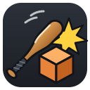

<p align="center">
  
</p>

<h1 align="center">Bonk! Model Prop-inator!</h1>

<p align="center">
  <b>Your Garry's Mod modeling tool for Linux!</b><br>
  A Hammer-style brush modeler that builds props (MDL + VMT + VTF) and compiles them with
  Garry's Mod's own studiomdl through Proton.
</p>

<p align="center">
  <a href="LICENSE"></a>
  
  
</p>

*Steventechno tools: replacing Windows tools, one at a time. Your Steam Deck, Steam Machine or
Linux PC is now your workstation!*

---

## What it does

Bonk is for making Garry's Mod props the way you'd build them in Hammer, without Windows, a VM,
or Propper.

- **Hammer-style editing:** four views, brushes you draw, size, move, rotate, mirror, clip
  (Bisect) and edit vertex by vertex, with Hammer-style keys available.
- **Shapes and quick building:** blocks, cylinders, wedges, spikes and orbs with a sides slider,
  right-drag Quick Draw for walls and floors, multi-vertex move / rotate / scale, and copy and
  paste between models and projects (textures come along).
- **Hold-key editing:** hold G to grab, S to size, R to rotate or Shift to carry a copy, from
  anywhere in a view. Moves lock to one axis (Alt frees them), the corner of the view says what
  the held key does, and the 3D view takes the editing keys too when you're not flying.
- **Textures done right:** a Texture Picker with folders, Face Select & Paint, Hammer-style
  alignment (shift, scale, rotate, justify, wrap, Texture Lock), and Material Properties that
  become the VMT: shaders, surface type, transparency, phong, normal / detail / mask maps,
  reflections, and scrolling, pulsing or animated materials that play in the 3D view.
- **Built-in VTF conversion:** drop PNG or JPG files in and Bonk writes the VTFs itself.
- **Collision models:** a separate collision layer you shape yourself, or one generated from the
  visual brushes (complete, or simplified automatically), with a live Budget bar and mass presets.
- **One-click compiling:** SMD + QC + VMT + VTF, then Garry's Mod's `studiomdl.exe` through
  Proton, into a ready-to-upload addon folder. File → Export to GMod Addons Folder drops it
  straight into the game.
- **Import from Hammer:** open a `.vmf` with its texture alignment, groups and visgroups, and
  bring its materials along from a `materials` folder or a Workshop `.gma`.
- **Projects:** one folder per addon, shared textures, and a start screen with recent projects
  and models.
- **Help built in:** Help → Bonk! Guide (F1) has every key and tool, a search box and a cheat
  sheet.

## Requirements

- Linux (made on Bazzite / KDE Plasma; any desktop works), or a Steam Deck in desktop mode.
- **To compile models:** Steam with **Garry's Mod** installed (Bonk uses its `bin/studiomdl.exe`)
  and a **Proton** version installed from Steam. Bonk finds both automatically, including
  Flatpak Steam.
- **To build Bonk:** Rust and Qt 6 (see below).

Bonk only touches the Garry's Mod folder for two things: running its `studiomdl.exe`, and writing
`garrysmod/addons/<project>` when you choose File → Export to GMod Addons Folder.

## Building

### The easy way

Download the source (a release archive, or `git clone`), then double-click **Build Bonk.sh**
(or run it from a terminal). It checks for Rust, a C++ compiler and Qt 6, offers to install
what's missing, builds Bonk, and puts the program with a desktop launcher in `Built Binaries`.
It can also add Bonk to your application menu.

On immutable systems (Bazzite, SteamOS, Silverblue/Kinoite, Bluefin, Aurora, openSUSE Aeon…)
nothing is installed on the base system: the build runs inside a distrobox or toolbox container.

```sh
git clone https://github.com/steventechno/bonk.git
cd bonk
./"Build Bonk.sh"
```

### By hand

You need Rust (via [rustup](https://rustup.rs)) and the Qt 6 base development package:

| Distro | Package(s) |
|---|---|
| Arch / EndeavourOS / SteamOS | `qt6-base` |
| Fedora | `qt6-qtbase-devel` |
| Ubuntu / Kubuntu / Debian / KDE neon | `qt6-base-dev qt6-base-dev-tools libgl-dev` |
| openSUSE | `qt6-base-devel qt6-openglwidgets-devel` |

```sh
cargo build --release      # the program ends up in target/release/bonk
cargo test                 # the test suite
```

`build.rs` finds Qt through pkg-config, then `qmake6` / `qmake`. To use a specific Qt, set
`QMAKE=/path/to/qt6/bin/qmake`. Bonk has no crate dependencies.

### Wayland note (Plasma 6)

Mouselook warps the cursor, and native Wayland doesn't allow normal apps to do that, so Bonk runs
through XWayland automatically on Wayland sessions. Set `BONK_WAYLAND=1` to force native Wayland
(mouselook will then hit the screen edges). Plasma 6 uses Meta, not Alt, for dragging windows,
so Alt+drag reaches Bonk; if you changed that setting, Alt+drag will move the window instead.

## Getting started

1. Open Bonk. The start screen offers **New Project**.
2. Drop PNG or JPG textures onto the Texture Picker, draw brushes with the Block tool (2), and
   paint faces with Face Select & Paint (6). Or bring in a Hammer map with
   **File → Import VMF…** (Ctrl+I).
3. Add a collision layer in the Layers pane, or let Bonk generate one when you compile.
4. **File → Compile Model** (F9), then **File → Export to GMod Addons Folder** (Ctrl+Shift+E).

Press **F1** at any time for the guide page about the tool you're using.

## Reporting bugs

Please [open an issue](../../issues/new/choose). If Bonk crashed, it wrote a log to
`~/.local/share/bonk/crash.log` and mentions it the next time it starts: attach that file.
**Help → About Bonk! → System Info** copies the versions and paths that help too.

## Project layout

```
Build Bonk.sh     one-click builder (installs what's missing, uses a container on immutable systems)
build.rs          finds Qt 6 and compiles the C++ host
assets/           the app icon and tool panel icons
cpp/host.cpp      Qt main window, docks, viewports, menus, projects, texture picker, settings, compiling
cpp/guide.inc     the Bonk! Guide (Help → F1) and the About dialog
cpp/importer.inc  Source material sources (folders, .gma) and the import dialogs
src/main.rs       C ABI bridge between Qt and the editor, crash log
src/editor.rs     tools, 2D views, camera, input handling
src/doc.rs        convex brushes, selection, groups, layers, undo/redo
src/io.rs         .bpmdl save / load
src/geom.rs       convex hulls, planes, picking
src/render.rs     OpenGL 3.3 core renderer for the 2D and 3D views
src/tex.rs        per-face texture mapping: lock, wrap, justify, fit
src/texstore.rs   decoded texture images handed over from Qt
src/export.rs     SMD export for studiomdl
src/vmf.rs        KeyValues, VMF import, VMT parsing
src/vtf.rs        VTF 7.2 writer with DXT1 / DXT5 compression
src/vtfread.rs    VTF 7.0–7.5 reader
src/gl.rs         tiny GL function loader
src/math.rs       vectors and matrices
```

See [CONTRIBUTING.md](CONTRIBUTING.md) for how the pieces fit together and how to send changes.

## Roadmap

- [x] Editor core: convex brushes, vertex tool, rotate, sizing, Bisect, Hammer-style keys
- [x] Layers (visual / collision), groups, scale mannequin, model origin, selection box
- [x] Projects, Texture Picker, textured 3D view, texture tools, Material Properties, VTF conversion
- [x] Compiling with Garry's Mod's studiomdl through Proton; export to the addons folder
- [x] VMF import with materials from folders or Workshop `.gma` files
- [x] Hold-key editing everywhere: G grab with axis lock, H hide, mirror, 3D nudging, FOV
- [x] Modeling power: Quick Draw, primitives, multi-vertex editing, copy between models, overlap check
- [x] Simplified collision, joining brushes, mass presets, compiler choice
- [ ] Workshop publishing
- [x] Shader work: shader picker (incl. MonitorScreen), more texture slots, live VMT editing
- [x] Animated, scrolling and pulsing materials; texture find / replace; paint by dragging
- [ ] Skins, bodygroups, LODs and an in-editor model preview
- [ ] Flathub release

Every release is listed in [CHANGELOG.md](CHANGELOG.md).

## Credits

Authored by **Claude Opus 5.5** (Anthropic), designed with input from **Steventechno**.
Designs inspired by Valve's Hammer editor, VTFEdit, SketchUp and Blender.

## License

Bonk! Model Prop-inator! is free software: you can redistribute it and/or modify it under the
terms of the **GNU General Public License, version 3 or (at your option) any later version**.
See [LICENSE](LICENSE).

Bonk is not affiliated with or endorsed by Valve Corporation or Facepunch Studios. Garry's Mod,
Source, Hammer, Steam and Proton are trademarks of their respective owners. Bonk does not include
any of their software; it runs the copy of studiomdl that comes with your own Garry's Mod install.
